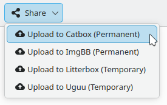

# KDE Purpose Plugins for Upload Services

Export plugins for **KDE Purpose** that add file and image upload services directly to the native **Share** menu in **KDE Plasma** (used by KDE apps like Spectacle, Dolphin, Gwenview, Krusader, etc.).

When you share a screenshot or file, the plugin uploads it to the selected service, copies the public link to your **Klipper** clipboard history, and displays a desktop **notification**.



### Motivation

KDE's built-in **Imgur** plugin is no longer usable due to restrictions on Imgur's end: **_quota exhaustion_** on the shared client key ([KDE Bug 515955](https://bugs.kde.org/show_bug.cgi?id=515955)), and **_no new API registration_** since Imgur permanently closed developer access.

This project restores working one-click sharing using active hosting services. Additionally, while Imgur only accepted images, several of these services (Uguu, Catbox, and Litterbox) also support **_any file format_**—allowing you to share logs, archives, documents, or videos directly from your file manager.

## Supported services

| Service                                       | Hosting type | Retention         | File types  | Max size | Authentication & configuration                                              |
| :-------------------------------------------- | :----------- | :---------------- | :---------- | :------- | :-------------------------------------------------------------------------- |
| [**Catbox**](https://catbox.moe)              | Permanent    | Indefinite        | Any file    | 200 MB   | Anonymous by default; optional account token in `catbox_userhash`           |
| [**ImgBB**](https://imgbb.com)                | Permanent    | Indefinite        | Images only | 32 MB    | Mandatory free API key in `imgbb_api_key`                                   |
| [**Litterbox**](https://litterbox.catbox.moe) | Temporary    | 1h, 12h, 24h, 72h | Any file    | 1 GB     | Anonymous; optional duration override in `litterbox_expiry` (default `72h`) |
| [**Uguu**](https://uguu.se)                   | Temporary    | ~3 hours          | Any file    | 100 MB   | Anonymous (no configuration needed)                                         |

All configuration files are stored in `~/.config/kde-purpose-plugins/` (`$XDG_CONFIG_HOME/kde-purpose-plugins/`).

More technical details about the [Supported Upload Services](docs/upload-services.md).

## Installation

### Prerequisites

The plugins rely on standard system tools and a single Python library:

- **Python 3** and the **requests** library (`python3-requests` or `python-requests`)
- **systemd** / **busctl** (included by default on systemd-based Linux systems for clipboard and notification desktop integration)

### Installation

1. Clone this repository:

   ```bash
   git clone https://github.com/midvok/kde-purpose-plugins.git
   cd kde-purpose-plugins
   ```

2. Run the installation script:

   ```bash
   # Install all available plugins (Python by default):
   ./install.sh

   # Or install only specific plugins:
   ./install.sh uguu_upload catbox_upload

   # Or install the standalone Bash variant of Uguu:
   ./install.sh -i bash uguu_upload
   ```

The script copies each plugin package into `~/.local/share/kpackage/Purpose/<plugin_id>/`. Because KDE Purpose dynamically scans plugin directories each time a Share menu is opened, newly installed plugins appear immediately without restarting applications or logging out.

To list available plugins or remove them:

```bash
./install.sh --list     # View available plugins
./install.sh --remove   # Remove all installed plugins
```

### Configuration

If you use services that require or support configuration, create the configuration directory and files:

```bash
mkdir -p ~/.config/kde-purpose-plugins
```

- **Catbox** (optional): Link uploads to your personal account dashboard by providing your account hash:
  ```bash
  echo "YOUR_CATBOX_USERHASH" > ~/.config/kde-purpose-plugins/catbox_userhash
  ```
- **ImgBB** (mandatory): Save your free API key obtained from [api.imgbb.com](https://api.imgbb.com/):
  ```bash
  echo "YOUR_IMGBB_API_KEY" > ~/.config/kde-purpose-plugins/imgbb_api_key
  ```
- **Litterbox** (optional): Customize expiration duration (`1h`, `12h`, `24h`, or `72h`):
  ```bash
  echo "24h" > ~/.config/kde-purpose-plugins/litterbox_expiry
  ```

### Disabling default Purpose plugins

By default, KDE Purpose populates the **Share** menu with system plugins (such as Bluetooth, Email, and the non-functional Imgur plugin). You can declutter the menu by disabling unwanted entries in `~/.config/purposerc`:

```ini
[plugins]
disabled=saveasplugin,bluetoothplugin,clipboardplugin,emailplugin,imgurplugin
```

To inspect which built-in plugins are installed on your distribution:

```bash
# On Fedora / openSUSE / Arch Linux:
ls /usr/lib64/qt6/plugins/kf6/purpose/

# On Debian / Ubuntu:
ls /usr/lib/*/qt6/plugins/kf6/purpose/
```

## Development notes

All production plugins in this repository are implemented in **Python** using standard library components and `python3-requests`. A reference implementation in pure **Bash** (`curl`-based) is also provided for Uguu.

The scripted design was chosen intentionally to avoid external build toolchains, compilation steps, or complex packaging. Deploying or modifying a plugin is a direct file operation.

For deeper technical details, refer to the project documentation:

- [How It Works](docs/how-it-works.md): Comprehensive architectural guide covering the KDE Purpose IPC lifecycle, Unix domain sockets, CBOR decoding, desktop integration via D-Bus, and strict protocol invariants.
- [Supported Upload Services](docs/upload-services.md): Complete service specifications, HTTP multipart form field contracts, response schemas, and standalone `curl` and Python `requests` command-line examples for each hosting provider.
