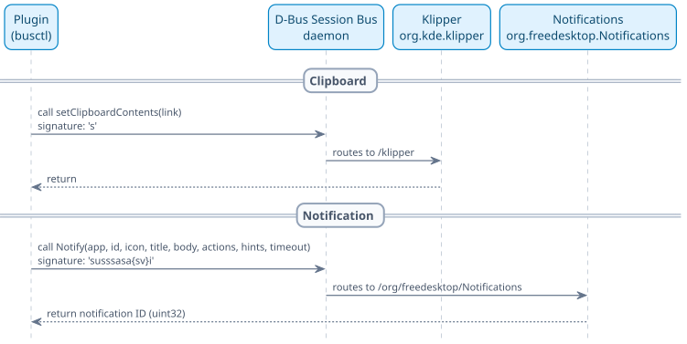

# How It Works

- [How It Works](#how-it-works)
  - [Foundational technologies](#foundational-technologies)
    - [Glossary](#glossary)
    - [Local IPC: Unix sockets and CBOR](#local-ipc-unix-sockets-and-cbor)
    - [Network uploads: Multipart HTTP, requests, and curl](#network-uploads-multipart-http-requests-and-curl)
    - [Desktop integration: D-Bus, busctl, and type signatures](#desktop-integration-d-bus-busctl-and-type-signatures)
  - [Plugin architecture](#plugin-architecture)
    - [Overview and components](#overview-and-components)
    - [Core protocol invariants](#core-protocol-invariants)
    - [Plugin discovery](#plugin-discovery)
    - [Plugin structure on disk](#plugin-structure-on-disk)
  - [Execution and implementation details](#execution-and-implementation-details)
    - [Step-by-step workflow](#step-by-step-workflow)
    - [Purpose protocol](#purpose-protocol)
    - [Upload procedure](#upload-procedure)
    - [Desktop integration](#desktop-integration)
    - [Error handling](#error-handling)
  - [What leaves your computer](#what-leaves-your-computer)
  - [References](#references)

## Foundational technologies

Before exploring plugin internals, it helps to understand the underlying Linux, networking, and KDE Plasma mechanisms used by the scripts.

### Glossary

| Term                                                                                                | Meaning                                                                                                        |
| :-------------------------------------------------------------------------------------------------- | :------------------------------------------------------------------------------------------------------------- |
| [**KDE Purpose**](https://en.wikipedia.org/wiki/KDE_Frameworks)                                     | The KDE framework behind Share menus that discovers and runs export plugins.                                   |
| [**KPackage**](https://en.wikipedia.org/wiki/KDE_Frameworks)                                        | KDE's standard packaging format for plugins, consisting of `metadata.json` and a `contents/` directory.        |
| [**XDG data dirs**](https://en.wikipedia.org/wiki/Freedesktop.org#XDG_Base_Directory_Specification) | Standard Linux data paths where plugins reside, such as `~/.local/share` and `/usr/share`.                     |
| [**Unix socket**](https://en.wikipedia.org/wiki/Unix_domain_socket)                                 | A bidirectional IPC channel on the local machine used by Purpose to control the plugin process.                |
| [**JSON**](https://en.wikipedia.org/wiki/JSON)                                                      | Text-based format used for plugin progress, result, and error messages sent back to Purpose.                   |
| [**CBOR**](https://en.wikipedia.org/wiki/CBOR)                                                      | Concise Binary Object Representation; the binary serialization format Purpose uses to transmit share requests. |
| [**MIME type**](https://en.wikipedia.org/wiki/Media_type)                                           | Standard file type identifier, such as `image/png`.                                                            |
| [**Multipart upload**](https://en.wikipedia.org/wiki/MIME#Multipart_messages)                       | Standard HTTP `multipart/form-data` request format used to upload files to web services.                       |
| [**D-Bus**](https://en.wikipedia.org/wiki/D-Bus)                                                    | The desktop IPC bus used to communicate with notifications and clipboard services.                             |
| [**busctl**](https://en.wikipedia.org/wiki/Systemd)                                                 | Command-line tool from systemd used to send D-Bus calls without external client libraries.                     |
| [**Klipper**](<https://en.wikipedia.org/wiki/Klipper_(software)>)                                   | Plasma's clipboard service that retains copied links after the plugin process exits.                           |

### Local IPC: Unix sockets and CBOR

KDE Purpose controls the plugin process using a private **Unix socket** and exchanges structured requests using **CBOR**.

#### Unix domain sockets

A **Unix domain socket** (`AF_UNIX`) is an Inter-Process Communication (IPC) endpoint represented as a file path on the filesystem (typically inside `/tmp/`).

- **Kernel memory transfer**: Unlike network sockets (`AF_INET`), Unix sockets bypass the entire network stack, loopback interface, and port allocation, passing data entirely through OS kernel memory buffers.
- **Isolated channel**: Standard I/O streams (`stdin` and `stdout`) can be corrupted by stray debug prints, warning messages from imported libraries, or subshell output. A dedicated Unix socket provides a clean, isolated stream.
- **Filesystem security**: Access is restricted using standard Linux file permissions on the socket file.

```python
# Server (KDE Purpose) creates and listens on the Unix socket:
import socket

server = socket.socket(socket.AF_UNIX, socket.SOCK_STREAM)
server.bind("/tmp/randomname-1286082386")
server.listen(1)
conn, _ = server.accept()

# Client (Plugin) connects to the socket path passed via --server:
sock = socket.socket(socket.AF_UNIX, socket.SOCK_STREAM)
sock.connect("/tmp/randomname-1286082386")
```

#### CBOR (Concise Binary Object Representation)

**CBOR** (RFC 8949) is a binary data serialization format modeled after JSON.

- **Data model parity**: CBOR supports the same data types as JSON (maps, arrays, text strings, numbers, booleans, and null).
- **Size comparison**: In payloads consisting mostly of text strings, CBOR and JSON have nearly identical sizes (69 bytes vs 69 characters) because both store strings as raw UTF-8 bytes. CBOR saves significant bandwidth on binary payloads (avoiding base64 overhead), packed numbers, and stripped whitespace.
- **Parsing speed**: The primary advantage for Qt is streaming binary deserialization: lengths are known before reading bytes, avoiding character escaping and delimiter scanning.

```python
# Conceptual comparison of JSON vs CBOR payload:

# JSON text representation (69 characters):
{"mimeType": "image/png", "urls": ["file:///home/user/Pictures/Screenshot.png"]}

# Equivalent CBOR binary representation (69 bytes):
# a2                                 -> map with 2 entries
# 68 6d 69 6d 65 54 79 70 65         -> text key "mimeType" (length 8)
# 69 69 6d 61 67 65 2f 70 6e 67      -> text value "image/png" (length 9)
# 64 75 72 6c 73                     -> text key "urls" (length 4)
# 81                                 -> array with 1 item
# 78 29 66 69 6c 65 3a 2f 2f 2f ...  -> text URL string (length 0x29 = 41)
```

##### Binary structure and header encoding

Every item in CBOR begins with an 8-bit header byte divided into a major type and additional information:

```
+---------------+-----------------------+
|  Major type   | Additional information|
| (bits 7 - 5)  |      (bits 4 - 0)     |
+---------------+-----------------------+
| 3 bits (0..7) |     5 bits (0..31)    |
+---------------+-----------------------+
```

- **Major type** (top 3 bits): Defines the data category: `0` (unsigned integer), `1` (negative integer), `2` (byte string), `3` (text string), `4` (array), `5` (map), `6` (semantic tag), or `7` (simple value / float).
- **Additional information** (low 5 bits): Defines the item's value or byte length:
  - Values `0` to `23`: Encode the value or length directly within the 5 bits.
  - Values `24` to `27`: Indicate that the length follows in the next 1 (`24`), 2 (`25`), 4 (`26`), or 8 (`27`) bytes.

For example, the initial byte `0xa2` breaks down into:

- Binary `10100010`: Top 3 bits `101` (decimal `5` = Map), low 5 bits `00010` (decimal `2` = 2 key-value pairs).

| Byte(s)     | Bit breakdown       | Major type      | Length or value | Decoded meaning                                 |
| :---------- | :------------------ | :-------------- | :-------------- | :---------------------------------------------- |
| `0xa2`      | `10100010`          | 5 (Map)         | 2               | Map containing 2 key-value pairs                |
| `0x68`      | `01101000`          | 3 (Text string) | 8               | String of 8 bytes: `"mimeType"`                 |
| `0x69`      | `01101001`          | 3 (Text string) | 9               | String of 9 bytes: `"image/png"`                |
| `0x64`      | `01100100`          | 3 (Text string) | 4               | String of 4 bytes: `"urls"`                     |
| `0x81`      | `10000001`          | 4 (Array)       | 1               | Array containing 1 item                         |
| `0x78 0x29` | `01111000` + `0x29` | 3 (Text string) | 41 (`0x29`)     | Length follows in next byte: 41-byte URL string |

##### Language support and script trade-offs

KDE Purpose's choice of CBOR reflects its C++ and Qt origins rather than script convenience:

- **C++ (Qt)**: Native support is built directly into Qt (`QCborValue`, `QCborMap`, `QCborStreamReader`). Purpose's C++ `ProcessJob` serializes requests with a single native call with zero external dependencies.
- **Rust**: Well-supported across the ecosystem via crates like `ciborium` or `serde_cbor`, allowing instant deserialization into typed structs without manual parsing code.
- **Python**: Standard library includes `json`, but has **_no built-in CBOR module_**. Because plugins cannot require external packages (`cbor2`) before connecting, `purpose_common.py` implements a self-contained 40-line decoder.
- **Bash**: Standard Linux distributions lack CLI tools for CBOR. `main.sh` extracts raw bytes with `od` and parses headers using pure Bash arithmetic.

For Python and Bash script authors, CBOR requires writing a custom decoder. However, because Purpose only emits definite-length maps, arrays, and strings, a minimal reader requires only ~40 lines of code.

### Network uploads: Multipart HTTP, requests, and curl

Uploading an image or document requires transmitting raw binary bytes alongside form field metadata.

#### Multipart form uploads

Standard HTTP POST requests send a single content type in the body (such as `application/json` or `application/x-www-form-urlencoded`). Binary files cannot be embedded directly in standard text forms without base64 encoding, which adds ~33% bandwidth overhead.

The `multipart/form-data` standard (RFC 7578) solves this by defining a unique **boundary** delimiter string in the `Content-Type` header:

- **Boundary as a separator line**: The boundary is a delimiter string that marks where each part begins and ends inside the HTTP request body.
- **Random generation**: The HTTP client generates this string randomly (e.g. `974767299852498929531610575`) so it is statistically guaranteed **_never to appear inside the file's binary content_**, preventing premature truncation.
- **Framing in the HTTP body**:
  - `--<boundary>`: Prepended with two dashes to mark the start of each part (followed by part headers and content).
  - `--<boundary>--`: Appended with two trailing dashes to mark the final boundary and end of the entire payload.

```http
POST /upload HTTP/1.1
Host: uguu.se
Content-Type: multipart/form-data; boundary=---------------------------974767299852498929531610575

-----------------------------974767299852498929531610575
Content-Disposition: form-data; name="files[]"; filename="Screenshot.png"
Content-Type: image/png

<raw binary bytes of the file>
-----------------------------974767299852498929531610575--
```

#### Bash curl

The standalone Bash implementation (`main.sh`) uses `curl`:

- The `-F` flag instructs `curl` to construct a `multipart/form-data` request.
- The `@` prefix specifies that the field value should be read from a local file path.
- Quotes and backslashes in filenames are escaped to ensure safe argument handling.

```bash
# Escape quotes and backslashes in filename:
escaped_path=${path//\\/\\\\}
escaped_path=${escaped_path//\"/\\\"}

# -F sends a multipart/form-data upload:
response=$(curl -sS --max-time 60 -w '\n%{http_code}' \
    -A "kde-purpose-plugins/1.0 (KDE Plasma)" \
    -F "files[]=@\"$escaped_path\"" \
    https://uguu.se/upload)
```

#### Python requests

The Python implementation uses the `requests` library (`python3-requests`):

- `requests` automatically constructs the multipart boundary header and streams file data in chunks directly from disk.
- Passing a tuple `(filename, file_handle, mime_type)` assigns the form field metadata without loading the entire file into memory.

```python
import mimetypes
import requests

USER_AGENT = "kde-purpose-plugins/1.0 (KDE Plasma)"

mime = mimetypes.guess_type(path)[0] or "application/octet-stream"
with open(path, "rb") as file_handle:
    response = requests.post(
        "https://uguu.se/upload",
        files={"files[]": ("Screenshot.png", file_handle, mime)},
        headers={"User-Agent": USER_AGENT},
        timeout=60,
    )
```

#### User-Agent identification and anti-bot filtering

Web hosting services and Content Delivery Networks (CDNs) often deploy anti-bot protections to prevent automated abuse and scraper spam.

- **Default Python User-Agent blocking**: During Catbox plugin development, uploads failed because the service and Cloudflare reverse proxies reject Python's default User-Agent (`python-requests/2.x.x`) with HTTP 403 or HTML challenge pages.
- **Browser spoofing vs explicit identification**: Setting a browser identity (`Mozilla/5.0 ...`) worked as an initial workaround, but the project standardizes on explicit, transparent client identification.
- **Project identifier**: The shared library `purpose_common.py` declares `USER_AGENT = "kde-purpose-plugins/1.0 (KDE Plasma)"` and passes it on all outgoing HTTP requests.

For full endpoint specifications, form field structures, and response schemas of every service, see [Supported Upload Services](upload-services.md).

### Desktop integration: D-Bus, busctl, and type signatures

The plugin interacts with the Plasma desktop using **D-Bus**, the standard inter-process messaging system on Linux desktops.



Desktop integration relies on three concepts:

- **D-Bus Session Bus**: A message bus daemon running within your login session (`DBUS_SESSION_BUS_ADDRESS`). Background services like Klipper and the notification server register well-known bus names (such as `org.kde.klipper` and `org.freedesktop.Notifications`) and expose methods at specific object paths.
- **busctl**: A systemd command-line tool that sends raw D-Bus method calls. Using `busctl` eliminates the need for heavyweight desktop dependencies (like `python-dbus` or Qt bindings), allowing both Python and Bash plugins to communicate with the desktop using built-in system tools.
- **D-Bus type signatures**: D-Bus is strongly typed. Every method call specifies a signature string detailing the exact data types of its arguments.

#### Demystifying type signatures

When making calls with `busctl`, the command requires a signature string matching the target method:

| Target method                                  | Signature       | Meaning of tokens                                                               |
| :--------------------------------------------- | :-------------- | :------------------------------------------------------------------------------ |
| `org.kde.klipper.klipper.setClipboardContents` | `s`             | `s`: single UTF-8 string containing the link URL to store in clipboard history. |
| `org.freedesktop.Notifications.Notify`         | `susssasa{sv}i` | Detailed below: 8 parameters describing the notification popup.                 |

The `susssasa{sv}i` signature breaks down into these parameter types:

| Token   | Type                                   | Parameter name   | Purpose                                                                                   |
| :------ | :------------------------------------- | :--------------- | :---------------------------------------------------------------------------------------- |
| `s`     | `STRING`                               | `app_name`       | Name of the application displayed in the notification header (`"Uguu"`).                  |
| `u`     | `UINT32`                               | `replaces_id`    | ID of a previous notification to replace (`0` creates a new notification).                |
| `s`     | `STRING`                               | `app_icon`       | Icon name (`"cloud-upload"` on success, `"dialog-error"` on failure).                     |
| `s`     | `STRING`                               | `summary`        | Single-line notification title.                                                           |
| `s`     | `STRING`                               | `body`           | Formatted body text (supports basic HTML tags: `<b>`, `<a>`, `<br>`).                     |
| `as`    | `ARRAY of STRING`                      | `actions`        | Action buttons (`0` denotes an empty array).                                              |
| `a{sv}` | `ARRAY of DICT_ENTRY<STRING, VARIANT>` | `hints`          | Metadata dictionary (e.g. `1 urgency y 2` marks failures as critical; `0` denotes empty). |
| `i`     | `INT32`                                | `expire_timeout` | Duration in milliseconds (`-1` defaults to the desktop setting; `0` never expires).       |

```bash
# Copy to clipboard via Klipper:
busctl --user call org.kde.klipper /klipper org.kde.klipper.klipper \
    setClipboardContents s "https://h.uguu.se/YoTANMRs.png"

# Display desktop notification:
busctl --user call -- org.freedesktop.Notifications /org/freedesktop/Notifications \
    org.freedesktop.Notifications Notify susssasa{sv}i \
    "Uguu" 0 "cloud-upload" "Uploaded to Uguu" "<b>Screenshot.png</b><br>Link copied." \
    0 0 -1
```

#### Plasma desktop specifics

Two desktop quirks make this integration necessary:

- **Clipboard persistence**: On X11 and Wayland, the clipboard is owned by the process that copied data. When that process exits, the copied text is lost unless a clipboard manager like **Klipper** claims and retains it.
- **Notification urgency**: Setting `urgency = 2` ensures error popups remain visible and do not automatically disappear before you read them.

## Plugin architecture

This section explains the design, discovery, packaging, and execution contracts that govern scripted export plugins for KDE Purpose.

### Overview and components

Scripted export plugins for **KDE Purpose** use a two-tier architecture:

- `purpose_common.py` is the shared protocol engine that handles **Unix socket** IPC, **CBOR** decoding, input validation, **Klipper** clipboard integration, and Plasma desktop **notifications**.
- `main.py` is the service adapter that defines the upload service endpoint, form fields, and response link extraction.

Currently, all production plugins in the repository are implemented in **Python**. A standalone **Bash** implementation (`main.sh`) is also provided as a dependency-free example. While compiled implementations in **C++** or **Rust** are technically possible, they require installing dedicated build toolchains and compiling binaries from source. The scripted approach was deliberately chosen to simplify deployment—installation is a direct file copy—and keep dependencies strictly minimal.


Five parties are involved in every share action:

- **Host app**: offers the Share menu and passes file URLs to Purpose. Spectacle saves screenshots to a temporary file before sharing.
- **KDE Purpose**: starts the plugin process and communicates with it over a private **Unix socket** (`ProcessJob`).
- **Plugin**: runs **_once per share_**, reads the file, uploads it, reports progress to Purpose, copies the link to the clipboard, and triggers a desktop notification.
- **Upload service** (e.g. Uguu, Catbox, Litterbox, ImgBB): receives the file over HTTPS and returns a public URL. This is the **_only party outside your computer_**.
- **Plasma desktop**: displays the desktop **notification** and retains the link in the **Klipper** clipboard history over **D-Bus**.

### Core protocol invariants

KDE Purpose has **_no documentation_** for scripted plugins; its protocol details come directly from its C++ source code. Four strict invariants govern the plugin lifecycle:

| Invariant                          | Description                                                                                                   | Consequence if violated                                                                                    |
| :--------------------------------- | :------------------------------------------------------------------------------------------------------------ | :--------------------------------------------------------------------------------------------------------- |
| **Connect first**                  | The plugin must connect to the `--server` **Unix socket** before running any code or imports that could fail. | Exiting before connecting causes Purpose to dereference a null pointer, which **_crashes the host app_**.  |
| **Read request before failing**    | The plugin must read the initial request from the socket before running dependency or file checks.            | Closing a socket that contains unread data resets the connection, and Purpose **_drops the error reply_**. |
| **Report error 100, never 1**      | Errors reported to Purpose must use error code `100` (`KJob::UserDefinedError`).                              | Spectacle treats error code `1` as **_cancelled by the user_** and silently discards the error message.    |
| **Slow extras after socket close** | **Klipper** clipboard updates and desktop **notifications** must run only after closing the Purpose socket.   | The host app **_never waits_** for desktop extras; closing the socket finishes the share task immediately. |

### Plugin discovery

KDE Purpose discovers available plugins dynamically by scanning directories at runtime.


Discovery follows these rules:

- Purpose rescans its plugin directories **_every time_** a Share menu opens, so new plugins appear immediately without restarting apps.
- A plugin must contain an executable `contents/code/main.*` file to be recognized.
- `metadata.json` must include `Export` in `X-Purpose-PluginTypes`.
- All conditions in `X-Purpose-Constraints` must match (such as verifying `exec:` binaries on `PATH` or filtering supported `mimeType` patterns).

### Plugin structure on disk

Each plugin is structured as a **KPackage** located in a Purpose plugin directory (`~/.local/share/kpackage/Purpose/<plugin_id>/`).

```
~/.local/share/kpackage/Purpose/uguu_upload/
├── metadata.json           ← name, icon, plugin type, constraints
└── contents/code/
    ├── main.py             ← executable Purpose starts (must match main.*)
    └── purpose_common.py   ← shared helper library imported by main.py
```

#### Required files

| File                              | Required | Role                                                                                  |
| :-------------------------------- | :------- | :------------------------------------------------------------------------------------ |
| `metadata.json`                   | yes      | Plugin metadata: unique identifier, menu label, icon, plugin type, and constraints.   |
| `contents/code/main.*`            | yes      | Executable invoked by Purpose. Any executable extension works (`main.py`, `main.sh`). |
| `contents/code/purpose_common.py` | Python   | Shared protocol helper. It must reside next to `main.py`.                             |

> [!important]
> Python resolves symlinked scripts before constructing `sys.path`. If `main.py` were a symlink, Python would search for imports in the target directory and fail to import `purpose_common.py`. Plugin files in the installed KPackage directory must be actual file copies.

#### Metadata configuration

The `metadata.json` file controls how the plugin is registered and presented:

```json
{
  "KPlugin": {
    "Id": "uguu_upload",
    "Name": "Upload to Uguu (Temporary)",
    "Icon": "cloud-upload"
  },
  "X-Purpose-PluginTypes": ["Export"],
  "X-Purpose-Constraints": ["exec:python3"]
}
```

- `Id` **_must be unique_**: without an explicit `Id`, Purpose defaults all scripted plugins to the name `main` and drops duplicates.
- `Name` and `Icon`: define the label and icon displayed in the Share menu.
- `X-Purpose-PluginTypes`: must include `Export` to appear in Share menus.
- `X-Purpose-Constraints`: gates plugin availability. `exec:python3` hides the entry if Python is not installed. Omitting `mimeType` constraints makes the plugin available for all file types.

## Execution and implementation details

This section traces the full execution lifecycle of an upload from the initial menu click to the final desktop notification.

### Step-by-step workflow


Every upload proceeds through five sequential phases:

- **Phase 1: Start**: Purpose creates a temporary **Unix socket** in `/tmp/` and starts the plugin process with `--server <socket_path>`.
- **Phase 2: Purpose protocol**: The plugin connects to the socket, reads and decodes the **CBOR** request, validates dependencies and the input file, and reports initial progress (`{"percent": 10}`).
- **Phase 3: Upload**: The plugin performs a single HTTPS multipart POST request to the upload service. This is the **_only network traffic_**.
- **Phase 4: Result**: The plugin sends the completed link (`{"percent": 100, "output": {"url": link}}`) and closes the socket. Purpose signals completion to the host app.
- **Phase 5: Desktop integration**: After the Purpose socket is closed, the plugin copies the link to **Klipper** and displays a Plasma **notification** via **D-Bus**.

### Purpose protocol

All messages in this phase remain entirely on the local machine.

#### Host app to Purpose

The host app passes an `inputData` object describing the items to share:

```json
{
  "mimeType": "image/png",
  "urls": ["file:///home/user/Pictures/Screenshot.png"]
}
```

Only file references are transferred; only the plugin reads file contents from disk.

#### Purpose to plugin: command-line arguments

Purpose launches the plugin with three arguments:

```
main.py --server /tmp/randomname-1286082386 --pluginType Export --pluginPath .../contents/code/main.py
```

Only `--server` is required; it provides the **Unix socket** path to connect to. The plugin ignores `--pluginType` and `--pluginPath`.

#### Purpose to plugin: socket request

Purpose transmits the request over the socket in two sequential parts:

1. **Payload length**: An ASCII integer indicating the byte count, followed by a newline (`\n`).
2. **CBOR payload**: The binary `inputData` structure of exactly that length.

```
69\n                                       ← payload length in bytes (ASCII)
a2 68 6d 69 6d 65 54 79 70 65 69 69 6d ...   ← 69 bytes of binary CBOR
```

The plugin reads the ASCII length line, reads that exact number of bytes from the socket, and passes them to `cbor_decode()`. This reconstructs the dictionary matching the host app's `inputData` object without external library dependencies (see [Binary structure and header encoding](#binary-structure-and-header-encoding) for the detailed byte breakdown).

#### Plugin to Purpose: status replies

The plugin communicates with Purpose by writing single-line **JSON** objects to the socket:

| Reply object                                                            | Timing          | Purpose action                                 |
| :---------------------------------------------------------------------- | :-------------- | :--------------------------------------------- |
| `{"percent": 10}`                                                       | Upload begins   | Updates the task progress indicator            |
| `{"percent": 100, "output": {"url": "https://h.uguu.se/AbCdEf.png"}}`   | Upload succeeds | Stores the link as the job result              |
| `{"error": 100, "errorText": "Upload failed (HTTP 413): File too big"}` | Upload fails    | Marks the job as failed with the error message |

The job ends as soon as the plugin closes the socket.

#### Purpose to host app: outcome handling

Host applications handle job completion differently:

| Host app                   | On success (`output.url`)                                           | On error (`errorText`)                                                  |
| :------------------------- | :------------------------------------------------------------------ | :---------------------------------------------------------------------- |
| **Spectacle**              | Remains silent; the plugin's desktop notification provides feedback | Displays an inline banner: _There was a problem sharing the image: ..._ |
| **Dolphin** / **Krusader** | Opens the returned link directly in the default web browser         | Varies by application; Krusader suppresses error dialogs                |

The plugin's own desktop **notification** **_always appears_**, ensuring consistent feedback across all host applications.

### Upload procedure

This is the only operation that transmits data over the network.

#### Plugin to service: request

The plugin issues an HTTPS `POST` request to `https://uguu.se/upload`:

- **Form field**: `files[]` containing the file stream, local filename, and detected **MIME type** (defaulting to `application/octet-stream`).
- **Headers**: Standard `User-Agent` and `multipart/form-data` boundary framing (constructed automatically by `requests` or `curl`).
- **Timeout**: Enforces a 60-second limit to avoid hanging the process on stalled network connections.

#### Service to plugin: response

Success response (HTTP 200):

```json
{
  "success": true,
  "files": [
    {
      "hash": "83936c3ac5ee07fc",
      "filename": "YoTANMRs.png",
      "mimetype": "image/png",
      "url": "https://h.uguu.se/YoTANMRs.png",
      "size": 201020,
      "dupe": false
    }
  ],
  "errors": []
}
```

The plugin extracts `files[0].url`.

Failure response (e.g. HTTP 413):

```json
{ "success": false, "errorcode": 413, "description": "File too big" }
```

The plugin formats this into `Upload failed (HTTP 413): File too big`. Non-JSON server responses fall back to `Upload failed (HTTP <status>): unexpected response`.

### Desktop integration

Desktop integration calls run only **_after closing the Purpose socket_** so the host application finishes immediately without waiting for desktop IPC. Both actions invoke **D-Bus** methods via **busctl**:

- **Klipper clipboard**: Calls `org.kde.klipper.klipper.setClipboardContents` with the public link URL, ensuring the link remains in clipboard history after the plugin exits.
- **Desktop notification**: Calls `org.freedesktop.Notifications.Notify` using the `susssasa{sv}i` signature:
  - **On success**: Displays title `"Uploaded to Uguu"`, icon `"cloud-upload"`, and a body with the clickable link and clipboard notice.
  - **On failure**: Displays title `"Uguu upload failed"`, icon `"dialog-error"`, the error message, and hint `urgency = 2` (critical) so the popup remains visible until dismissed.

> [!tip]
> Notifications from CLI tools without desktop entries appear under _Other applications_ in Plasma. To preserve them in notification history after popups close, enable _Show in history_ for Other applications in System Settings › Notifications.

### Error handling

All failures follow a single consistent path:

- The error is captured after establishing the **Unix socket** connection.
- An error object (`{"error": 100, "errorText": "..."}`) is sent over the socket to inform Purpose and the host app.
- The socket is closed.
- A critical Plasma desktop **notification** is displayed.
- The plugin exits with status code `1`.


#### Common error messages

| Error text                                                        | Cause                                                                                                                       |
| :---------------------------------------------------------------- | :-------------------------------------------------------------------------------------------------------------------------- |
| `File not found: /tmp/Spectacle..../...png`                       | Spectacle shared a region selection before clicking Accept ([KDE bug 525554](https://bugs.kde.org/show_bug.cgi?id=525554)). |
| `Not a regular file: ...`                                         | A directory was selected instead of a file.                                                                                 |
| `Select exactly one file (got N).`                                | Multiple files were selected for a single-file plugin.                                                                      |
| `Python module 'requests' is required: install python3-requests.` | The `requests` Python package is missing.                                                                                   |
| `'busctl' is required but not installed.`                         | `busctl` binary is not found on `PATH`.                                                                                     |
| `Upload failed: cannot connect to uguu.se.`                       | Network offline, DNS failure, or firewall blocking the connection.                                                          |
| `Upload timed out after 60 s.`                                    | Slow network connection or large file exceeding timeout.                                                                    |
| `Upload failed (HTTP 413): File too big`                          | File size exceeds service upload limits.                                                                                    |
| `Internal error: ...`                                             | Unhandled exception; traceback is printed to standard error (host app log).                                                 |

## What leaves your computer

Only the upload request leaves your machine. The **Unix socket** IPC and **D-Bus** calls remain strictly local.

| Sent to upload service                      | Kept strictly local                                          |
| :------------------------------------------ | :----------------------------------------------------------- |
| File content bytes                          | Full local file paths and unshared files                     |
| File basename (e.g. `Screenshot.png`)       | User credentials, tokens, or cookies (service requires none) |
| MIME type inferred from filename            | Clipboard contents and notification history                  |
| IP address and `python-requests` User-Agent | Host application details                                     |

> [!warning]
> Uploaded links are **_public_**. Anyone with the link can view the file until the service deletes it (typically within a few hours). **_Never share sensitive or private files_** through temporary hosting services.

## References

KDE Purpose implementation details from the [KDE Purpose repository](https://invent.kde.org/frameworks/purpose):

| Source file                                        | Relevant functionality                                                                 |
| :------------------------------------------------- | :------------------------------------------------------------------------------------- |
| `src/alternativesmodel.cpp`                        | Discovery of `kpackage/Purpose/*/metadata.json` and constraint checks                  |
| `src/helper.cpp`                                   | Executable lookup for `contents/code/main.*`                                           |
| `src/externalprocess/processjob.cpp`               | Socket lifecycle, CBOR request transmission, JSON reply parsing, and null-socket crash |
| `src/fileitemactionplugin/sharefileitemaction.cpp` | Dolphin and Krusader menu integration and automatic link browser launch                |

Spectacle Share menu implementation details from the [KDE Spectacle repository](https://invent.kde.org/graphics/spectacle):

| Source file              | Relevant functionality                                                   |
| :----------------------- | :----------------------------------------------------------------------- |
| `src/Gui/ExportMenu.cpp` | Share menu construction and treating error code `1` as user cancellation |
