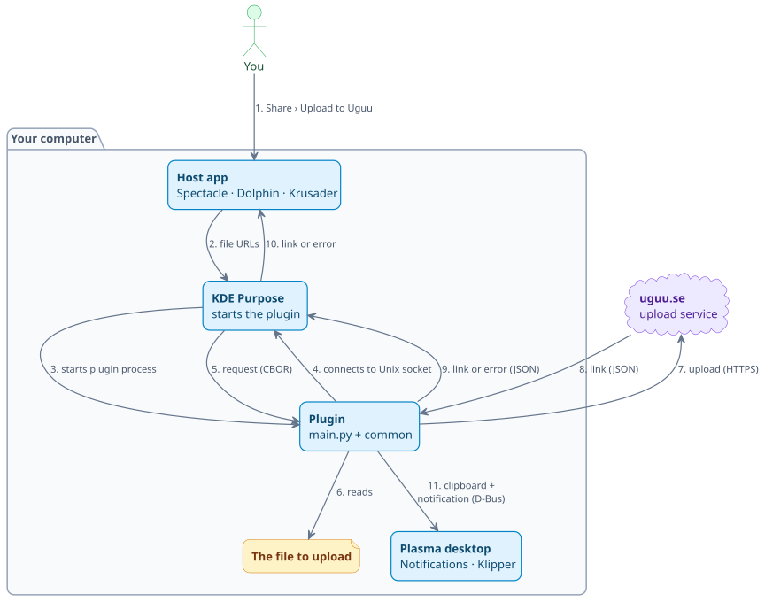
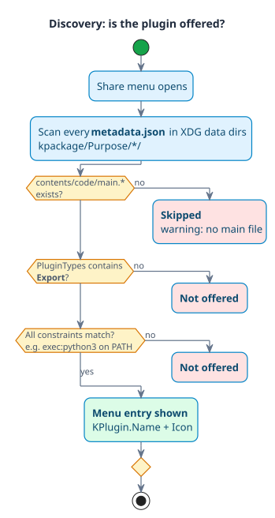
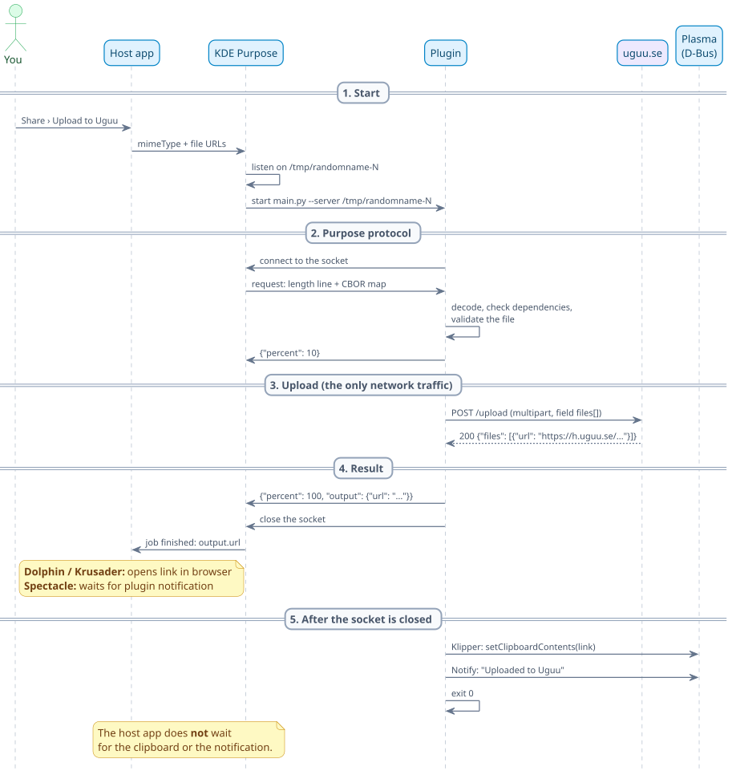
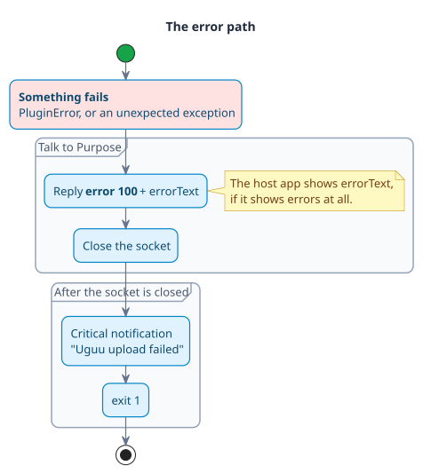

# How it works

This document explains what happens when you pick **Share › Upload to Uguu** in
Spectacle, Dolphin or Krusader.

In short:

- The host app says which file to share.
- **KDE Purpose** starts the plugin and talks to it over a **Unix socket**.
- The plugin **uploads** the file to **Uguu** and gets back a public link.
- The plugin sends the link to Purpose, copies it to the **clipboard** and
  shows a **notification**.
- If anything fails, you get the **error message** as a notification too.

The plugins are written for **KDE Purpose**, the framework behind every KDE
Share menu. Purpose has **_no documentation_** for scripted plugins. The
details below come from its source code (see [References](#references)).

## Key terms

| Term                 | Meaning                                                                                                                        |
| -------------------- | ------------------------------------------------------------------------------------------------------------------------------ |
| **KDE Purpose**      | The KDE framework behind every Share menu. It finds plugins and runs them.                                                     |
| **Host app**         | The app whose Share menu you use: Spectacle, Dolphin or Krusader.                                                              |
| **KPackage**         | KDE's folder format for plugins: a `metadata.json` plus a `contents/` folder.                                                  |
| **XDG data dirs**    | The standard Linux folders for app data, e.g. `~/.local/share` and `/usr/share`.                                               |
| **Unix socket**      | A private channel between two programs on the same computer. It works like a network connection, but never leaves the machine. |
| **JSON**             | A common text format for structured data: `{"key": "value"}`.                                                                  |
| **CBOR**             | A binary form of JSON. Same structure (maps, lists, text, numbers), but stored as compact bytes instead of text.               |
| **MIME type**        | A label for the kind of file, e.g. `image/png`.                                                                                |
| **Multipart upload** | The standard way a browser sends a file in an HTTP request (`multipart/form-data`).                                            |
| **D-Bus**            | The message system desktop programs use to talk to each other.                                                                 |
| **busctl**           | A command-line tool (part of systemd) that sends D-Bus messages.                                                               |
| **Klipper**          | Plasma's clipboard manager. It keeps the clipboard text after the program that set it has exited.                              |

## The big picture

Five parties are involved. Only one of them, the upload service, is
**_outside your computer_**.



- **Host app**: offers the Share menu and says which files to share.
  Spectacle first saves the screenshot to a temporary file.
- **KDE Purpose**: finds the plugins and starts the chosen one as a separate
  process. It talks to it over a **Unix socket** (`ProcessJob`).
- **Plugin**: `main.py` knows the upload service. `purpose_common.py` handles
  everything else. It runs **_once per share_**, then exits.
- **Upload service** (uguu.se): stores the file and returns a public link.
- **Plasma desktop**: shows the **notification** and keeps the link in the
  **clipboard** (**Klipper**). The plugin reaches it over **D-Bus**.

#### Discovery: how the menu entry appears

KDE Purpose rescans its plugin folders **_every time_** a Share menu opens. There is nothing to register and no restart needed.



## Plugin installation

Each plugin is a **KPackage** folder in a **Purpose** plugin directory. You
don't need to build or register anything: **_copying the folder is the whole
installation_**.

### Installed layout

`install.sh` creates this folder for every plugin:

```
~/.local/share/kpackage/Purpose/uguu_upload/
├── metadata.json           ← name, icon, plugin type, constraints
└── contents/code/
    ├── main.py             ← the executable Purpose starts (must match main.*)
    └── purpose_common.py   ← shared code, imported by main.py
```

### Required files

| File                              | Required | Role                                                                       |
| --------------------------------- | -------- | -------------------------------------------------------------------------- |
| `metadata.json`                   | yes      | Describes the plugin: name, icon, plugin type, constraints.                |
| `contents/code/main.*`            | yes      | The executable Purpose starts. Any extension works (`main.py`, `main.sh`). |
| `contents/code/purpose_common.py` | Python   | Shared code. It must sit **_next to_** `main.py`.                          |

> [!IMPORTANT]
> `install.sh` **_copies_** the files instead of linking them. Python resolves
> a symlinked `main.py` before it looks for imports, so it would not find
> `purpose_common.py`. Rerun `install.sh` after every change.

### The metadata file

`metadata.json` decides whether and how the plugin appears in the menu:

```json
{
  "KPlugin": { "Id": "uguu_upload", "Name": "Upload to Uguu (Temporary)", "Icon": "cloud-upload" },
  "X-Purpose-PluginTypes": ["Export"],
  "X-Purpose-Constraints": ["exec:python3"]
}
```

- `Id` **_must be set_**.
  - Without it, every scripted plugin is called `main`.
  - Purpose then drops all but one of them as duplicates.
- `Name` and `Icon` are what you see in the Share menu.
- `Export` makes it a Share menu plugin.
- `exec:python3` hides the entry when Python is missing.
  - That is safer than failing at run time (see
    [Connect first](#connect-first)).
- There is no `mimeType` constraint, so the entry appears for **_every file
  type_**.

## One upload, step by step



The upload runs in five phases:

1. **Start**: Purpose opens a **Unix socket** and starts the plugin.
2. **Purpose protocol**: the plugin connects, reads the request and reports
   progress.
3. **Upload**: one HTTPS request to uguu.se. This is the **_only network
   traffic_**.
4. **Result**: the plugin sends the link and closes the socket. Purpose tells
   the host app the job is done.
5. **After the socket is closed**: **clipboard** and **notification**. The host
   app **_never waits_** for them.

## The data, message by message

### The Purpose protocol

All messages in this part stay on your computer.

#### Host app → Purpose

The host app describes what to share as a small **JSON** object (`inputData`):

```json
{
  "mimeType": "image/png",
  "urls": ["file:///home/user/Pictures/Screenshot.png"]
}
```

- Only **_references_** to the file are passed around.
- Only the plugin reads the file itself.

#### Purpose → plugin: the command line

```
main.py --server /tmp/randomname-1286082386 --pluginType Export --pluginPath …/contents/code/main.py
```

- Only `--server` matters: it is the **Unix socket** to connect to.
- The plugin ignores the other two arguments.
- Nothing arrives on standard input.

#### Purpose → plugin: the request

Purpose sends two things over the socket:

1. The payload size in bytes, as a text line.
2. The `inputData` from above, encoded as **CBOR**.

```
69\n                                       ← payload length in bytes, as text
a2 68 6d 69 6d 65 54 79 70 65 69 69 6d …   ← 69 bytes of CBOR
```

> [!NOTE]
> **CBOR** (Concise Binary Object Representation) stores the same data as
> JSON, but as bytes instead of text. Each value starts with a small header
> that says what it is (map, list, text …) and how long it is. Programs can
> read it without parsing quotes, commas or brackets.

The complete 69-byte payload, decoded:

| Bytes              | Meaning                                                                                  |
| ------------------ | ---------------------------------------------------------------------------------------- |
| `a2`               | map with 2 entries                                                                       |
| `68` + 8 bytes     | text (8): `mimeType`                                                                     |
| `69` + 9 bytes     | text (9): `image/png`                                                                    |
| `64` + 4 bytes     | text (4): `urls`                                                                         |
| `81`               | array with 1 item                                                                        |
| `78 29` + 41 bytes | text (length in the next byte: `0x29` = 41): `file:///home/user/Pictures/Screenshot.png` |

How to read it:

- Each item starts with a **_header byte_**.
  - The top 3 bits are the type: 5 = map, 4 = array, 3 = text.
  - The low 5 bits are the length.
- Lengths of 24 and up move into the following byte(s). That is why the long
  URL needs `78 29`.
- This is **_all_** `cbor_decode()` in `purpose_common.py` has to understand.

#### Plugin → Purpose: the replies

The plugin answers with **_one JSON object per line_**:

| Line                                                                    | When          | Purpose does                               |
| ----------------------------------------------------------------------- | ------------- | ------------------------------------------ |
| `{"percent": 10}`                                                       | upload starts | updates the progress                       |
| `{"percent": 100, "output": {"url": "https://h.uguu.se/AbCdEf.png"}}`   | success       | stores the link as the job's result        |
| `{"error": 100, "errorText": "Upload failed (HTTP 413): File too big"}` | failure       | marks the job as failed, with that message |

The job ends when the plugin process exits.

#### Purpose → host app: the result

| Result                 | Spectacle                                                  | Dolphin, Krusader                          |
| ---------------------- | ---------------------------------------------------------- | ------------------------------------------ |
| success (`output.url`) | shows nothing: the plugin's notification is the feedback   | Purpose opens the link in the browser      |
| error (`errorText`)    | inline message: _There was a problem sharing the image: …_ | depends on the app, Krusader shows nothing |

The plugin's own **notification** **_always appears_**, whatever the host app
does.

### The upload

This is the only part that goes over the network.

#### Plugin → Uguu: the request

A single HTTPS request, a standard **multipart upload** like a browser sends:

```http
POST /upload HTTP/1.1
Host: uguu.se
User-Agent: python-requests/2.34.2
Content-Type: multipart/form-data; boundary=a1b2c3

--a1b2c3
Content-Disposition: form-data; name="files[]"; filename="Screenshot.png"
Content-Type: image/png

<the file's bytes>
--a1b2c3--
```

- The file's **MIME type** (`Content-Type`) is guessed from its name.
- Filenames with characters like `"` are encoded safely by `requests`
  (as `%22`).

#### Uguu → plugin: the response

Success (HTTP 200):

```json
{
  "success": true,
  "files": [
    {
      "hash": "83936c3ac5ee07fc",
      "filename": "YoTANMRs.png",
      "mimetype": "image/png",
      "url": "https://h.uguu.se/YoTANMRs.png",
      "size": 201020,
      "dupe": false
    }
  ],
  "errors": []
}
```

The plugin only uses `files[0].url`.

Failure (e.g. HTTP 413):

```json
{ "success": false, "errorcode": 413, "description": "File too big" }
```

- The plugin turns this into the **error message**
  `Upload failed (HTTP 413): File too big`.
- If the body is not JSON (e.g. an HTML error page), the message ends with
  `unexpected response` instead.

### The desktop

Both calls below are **D-Bus** messages sent with **busctl**. Since busctl is
part of systemd, **_no extra packages_** are needed.

#### Clipboard

The link goes to **Klipper**, which keeps it after the plugin exits:

| Service           | Object     | Method                 | Argument |
| ----------------- | ---------- | ---------------------- | -------- |
| `org.kde.klipper` | `/klipper` | `setClipboardContents` | the link |

#### Notification

The **notification** uses the standard freedesktop interface that Plasma
implements:

| Argument | Value                                                           |
| -------- | --------------------------------------------------------------- |
| app name | `Uguu`                                                          |
| icon     | `cloud-upload` (`dialog-error` on failure)                      |
| summary  | `Uploaded to Uguu` / `Uguu upload failed`                       |
| body     | file path, clickable link, clipboard status (or the error text) |
| hints    | `urgency = 2` (critical) on failure, none on success            |
| timeout  | `-1` = Plasma's default                                         |

> [!TIP]
> Plasma files notifications from apps without a desktop file under
> _Other applications_. To keep them in the history after the popup closes,
> enable _Show in history_ for Other applications in
> System Settings › Notifications.

## Errors

Every failure takes the **_same path_**:

- The host app gets the **error message**.
- You get it too, as a **notification**, whether or not the host app shows it.



### The four rules

> [!IMPORTANT]
> Four rules from Purpose's source shape `run()`. Breaking any of them makes
> the share fail badly. Each one is covered by a test case.

#### Connect first

- If the plugin exits without ever connecting, Purpose uses a socket that
  does not exist (a null pointer). **_The host app crashes._**
- So nothing that could fail runs before `connect()`. Not even importing
  `requests`.

#### Read the request before anything can fail

- Closing a **Unix socket** that still holds unread data **_resets_** it.
- Purpose then loses the **error message**.
- So dependency checks run after `read_request()`.

#### Error code 100, never 1

- Spectacle treats code 1 as **_cancelled by the user_** and silently drops
  the message.
- 100 is KDE's "user-defined error".

#### Slow extras after closing

- **Clipboard** and **notification** run after the socket is closed.
- So the host app **_never waits_** for them.

### Error messages

| Error text                                                        | Typical cause                                                                                                            |
| ----------------------------------------------------------------- | ------------------------------------------------------------------------------------------------------------------------ |
| `File not found: /tmp/Spectacle.…/…png`                           | Spectacle shared from the region selection before Accept ([KDE bug 525554](https://bugs.kde.org/show_bug.cgi?id=525554)) |
| `Not a regular file: …`                                           | a folder was shared                                                                                                      |
| `Select exactly one file (got N).`                                | several files selected                                                                                                   |
| `Python module 'requests' is required: install python3-requests.` | missing dependency                                                                                                       |
| `'busctl' is required but not installed.`                         | missing dependency (systemd)                                                                                             |
| `Upload failed: cannot connect to uguu.se.`                       | offline, DNS, firewall                                                                                                   |
| `Upload timed out after 60 s.`                                    | slow network or large file                                                                                               |
| `Upload failed (HTTP 413): File too big`                          | the service's own error message                                                                                          |
| `Internal error: …`                                               | a bug, with the full traceback in the host app's log                                                                     |

## What leaves your computer

- Only the [upload request](#plugin--uguu-the-request) goes over the network.
- Everything else **_stays local_**: the **Unix socket** is local, and
  **D-Bus** goes to your own session.

| Sent to uguu.se                                                                | Not sent                                     |
| ------------------------------------------------------------------------------ | -------------------------------------------- |
| the file's content                                                             | the full path, other files                   |
| the file's name, e.g. `Screenshot.png`                                         | any account, key or cookie (Uguu needs none) |
| its MIME type, guessed from the name                                           | your clipboard or notifications              |
| your IP address and `python-requests` as User-Agent (part of any HTTP request) |                                              |

> [!WARNING]
> The link is **_public_**.
>
> - Anyone who has the link can open the file.
> - It stays online until Uguu deletes it, a few hours after the upload.
> - **_Don't share anything private_** this way.

## References

All in the KDE Purpose source
([invent.kde.org/frameworks/purpose](https://invent.kde.org/frameworks/purpose)):

| File                                               | What it shows                                                          |
| -------------------------------------------------- | ---------------------------------------------------------------------- |
| `src/alternativesmodel.cpp`                        | discovery of `kpackage/Purpose/*/metadata.json`, constraint checks     |
| `src/helper.cpp`                                   | the `contents/code/main.*` lookup                                      |
| `src/externalprocess/processjob.cpp`               | the socket protocol, CBOR request, JSON replies, the null-socket crash |
| `src/fileitemactionplugin/sharefileitemaction.cpp` | Dolphin / Krusader integration, opening the link                       |

And in Spectacle
([invent.kde.org/graphics/spectacle](https://invent.kde.org/graphics/spectacle)):

- `src/Gui/ExportMenu.cpp` handles the Share menu.
- It treats error code 1 as cancelled.
